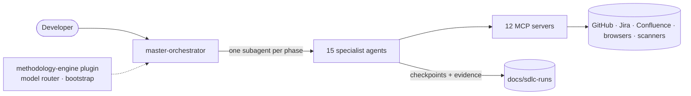

# Agentic SDLC

**A multi-agent framework that takes a feature from idea to pull request, plus 12 MCP servers
that give the agents real tools for traceability, security, testing and UX.**

[](https://github.com/aideveloper1976-arch/agentic-sdlc/actions/workflows/ci.yml)
[](https://github.com/aideveloper1976-arch/agentic-sdlc/actions/workflows/codeql.yml)
[](LICENSE)

<!-- DEMO: replace with a GIF of `/run-full-sdlc` on examples/ (see docs/demo.md) -->

```
/run-full-sdlc "Add CSV export to the reports page"
```

One command runs an 18-phase lifecycle: research, backlog, UX design, architecture (with a
human sign-off gate), TDD build, regression, browser UI tests, UX review, code review, security
review, traceability, and a GitHub PR. Each phase is handled by a specialist subagent that
writes reviewable evidence to disk.

## Why it's interesting

- **Orchestration that fits in one context window.** The orchestrator dispatches each phase
  to a fresh subagent and keeps only a one-line pointer to its checkpoint file, so a full
  18-phase run doesn't exhaust context, and `/continue-sdlc` can resume from disk.
- **Cost-aware model routing.** A plugin classifies the configured models (Ollama, OpenAI,
  Anthropic, DeepSeek, Gemini) into capability tiers and gives each agent the cheapest model
  that meets its needs: local models for routine agents, frontier models for orchestration.
  Verified end to end in OpenCode (see [framework/README.md](framework/README.md#model-discovery--routing)).
- **Gates that block.** Code review, security and traceability are enforced checks backed by
  tools, not prompts. A story isn't done without linked research, tests and evidence.
- **Real tools over model memory.** 12 TypeScript MCP servers (~17k lines) handle the things
  that must be correct: secret and dependency scanning, WCAG contrast maths, Playwright E2E
  and visual diffs, a SQLite traceability graph synced to Jira and Confluence.
- **Used in production.** 18 runs on a live B2B SaaS platform. See the
  [case study](docs/case-studies/observability-run.md).

## Architecture



More detail in [docs/architecture.md](docs/architecture.md).

## What's in the repo

| Path | Contents |
|---|---|
| [`framework/`](framework) | OpenCode plugin (model router, bootstrap, compaction hints), 15 agents, 9 slash commands, methodology and role skills, `AGENTS.md` phase rules, example config |
| [`mcp-servers/`](mcp-servers) | 12 MCP servers: traceability, security, test-automation, ux-hci, ux-intelligence, browser-research, web-downloader, document-intake, code-execution, monitoring, github, atlassian. See [docs/mcp-servers.md](docs/mcp-servers.md) |
| [`packages/browser-pool`](packages/browser-pool) | Shared Chromium pool for the browser-driven servers |
| [`installer/`](installer) | One-command installer (bash + PowerShell) that builds the servers and writes MCP config for **Claude Code, OpenCode, VS Code and Zed** |
| [`docs/`](docs) | Architecture, server reference, case study |

## Quick start

Requirements: Node.js 20+, git. Optional: Docker, Trivy, gitleaks, Ollama.

```bash
git clone https://github.com/aideveloper1976-arch/agentic-sdlc.git
cd agentic-sdlc
npm ci && npm run build      # build all MCP servers
npm run check                # typecheck + tests
```

Use the framework in your own project:

```bash
cp -r framework/.opencode framework/AGENTS.md /path/to/your-project/
cp framework/opencode.example.json /path/to/your-project/opencode.json   # edit paths + env vars
cd /path/to/your-project && opencode
> /run-full-sdlc "your feature"
```

Or install every server into all your AI clients at once:

```bash
cd installer && ./scripts/install.sh      # Windows: .\scripts\install.ps1
```

## Commands

| Command | What it does |
|---|---|
| `/run-full-sdlc <idea>` | All 18 phases, idea to PR |
| `/discover-and-write-backlog <idea>` | Research, competitor analysis, USP, EPIC → Feature → Story |
| `/build-story <story>` | Build, test, review, secure and trace one story |
| `/fix-issue <bug>` | Reproduce → failing test → fix → verify → commit |
| `/quick-change <change>` | Small change with the minimum safe gates |
| `/traceability-check` | Gap report across the traceability graph |
| `/continue-sdlc <phase>` | Resume a run from its checkpoints |
| `/show-routing` | Show the current model routing table |

## Tech

TypeScript · Node.js · Model Context Protocol · OpenCode plugins · Playwright · axe-core ·
SQLite (better-sqlite3) · zod · GitHub Actions (CI, CodeQL, gitleaks, Dependabot)

## Credits

The methodology skills are adapted from [obra/superpowers](https://github.com/obra/superpowers)
(MIT). See [THIRD_PARTY_NOTICES.md](THIRD_PARTY_NOTICES.md).

## License

[MIT](LICENSE)
