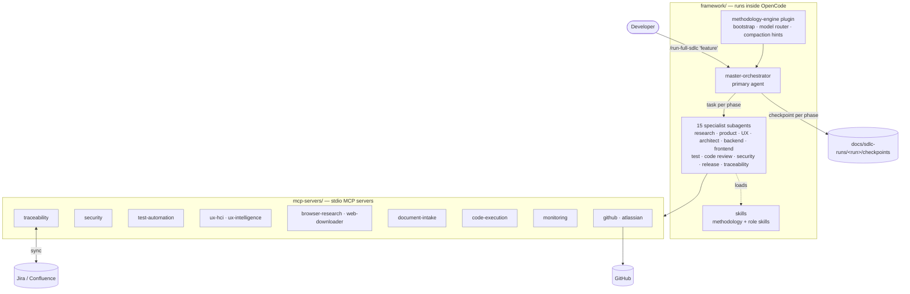

# Architecture

Agentic SDLC has three layers: a **framework** that runs inside an AI coding agent
(OpenCode, with configs generated for Claude Code, VS Code and Zed), a set of **MCP servers**
that give the agents real tools, and an **installer** that builds and wires everything up.



## The 18-phase lifecycle

```
Idea → Research → Competitor analysis → USP → EPIC → Feature → Story → UX design
     → Architecture review → ⏸ human sign-off → Implementation plan → Build
     → Self-verification → Code regression → Browser UI regression → UX/HCI review
     → Code review gate → Security review → Traceability gap report → UAT
     → GitHub PR → Release → Monitoring
```

Each phase is dispatched by the orchestrator to a fresh subagent. The subagent writes a
checkpoint file and returns only `DONE <path>`, so the orchestrator's context stays small
enough to run all phases in one session. `/continue-sdlc` resumes a run from its
checkpoints after a session ends.

Gates are enforced, not advisory: a story is not "done" without upstream research, an EPIC and
Feature parent, acceptance criteria, implementation evidence, test evidence and, where
relevant, browser regression, UX, security and release evidence. The traceability server
records each of these links and reports gaps.

## Model routing

The plugin reads the models configured in OpenCode, classifies each into a capability tier,
and assigns every agent the cheapest model whose tier meets that agent's `model_strength`
(local first, frontier last). This runs in OpenCode's `config` hook, so it changes which
model each agent actually uses:

| Tier | Used for | Typical models |
|---|---|---|
| `reasoning` | orchestration, complex implementation | GPT-5.x, Claude Opus/Sonnet, 70B+ local |
| `code-review` | spec and quality review | GPT-4.x, Claude Sonnet, 14B+ local |
| `code-capable` | standard implementation | GPT-4.1-mini, Claude Haiku, Mixtral |
| `fast-local` | mechanical TDD steps | Llama 3.1 8B, Qwen 2.5 7B |
| `fast` | cheap utility calls | any local or mini model |

A role-level routing table is also built from the profile in `methodology-config.json`,
cached by a SHA-256 hash of the model set, and shown in the first message.

Checked end to end with OpenCode 1.19.6 and a stub model server: with Opus, Sonnet, Haiku and
a local Llama 3.1 8B configured, the orchestrator ran on Opus, `architect` (complex) on
Sonnet and `story-writer` (standard) on the local 8B model.

## Dynamic agents (library, not yet wired in)

`lib/agent-factory.js` can write a temporary subagent to
`.opencode/agents/dynamic/<hash>.md`, picks its model from the routing table, and defaults
every shell command to `ask`. The same task description always maps to the same agent, so
retries reuse it and can escalate to a stronger model tier. No hook or command calls it yet.

## Design decisions

- **MCP over prompts.** Anything that must be correct (scans, contrast ratios, traceability
  links, test runs) is a tool call with structured output, not something the model is asked
  to remember.
- **Evidence on disk.** Every phase writes Markdown checkpoints and evidence files that can be
  reviewed in a PR, so a human can audit what the agents did.
- **Human gate before build.** Architecture sign-off is the one phase the orchestrator will
  not skip.
- **Safe by default.** Command allowlists in `code-execution-mcp`, `ask` permissions for
  generated agents, and no credentials anywhere in the repo.
