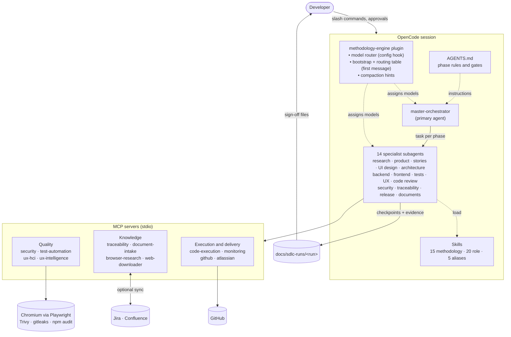

# Architecture

Agentic SDLC has three layers:

1. **Framework**: an OpenCode plugin, agent definitions, slash commands, skills and phase rules
   that turn a coding assistant into an orchestrated delivery team.
2. **MCP servers**: twelve TypeScript servers that give the agents deterministic tools.
3. **Installer**: builds the servers and writes MCP configuration for OpenCode, Claude Code,
   VS Code and Zed.

## System context



## Key mechanisms

### Phase dispatch
The orchestrator runs each phase in a fresh subagent and keeps one line per phase
(`Phase N done → <path>`). This is what lets a long run fit in one session and resume from disk.
See [ADR 0001](adr/0001-one-subagent-per-phase.md) and the [lifecycle](sdlc-lifecycle.md).

### Evidence and gates
Quality phases block on findings and route failures to a fix loop. Three human sign-offs
(design, architecture, UAT) stop the run until approved. The traceability server records the
links between research, backlog, code, tests and release, and reports gaps.
See [ADR 0003](adr/0003-evidence-and-human-gates.md).

### Model routing
In OpenCode's `config` hook the plugin assigns each agent the cheapest configured model that
meets its capability tier. Verified in a live OpenCode session.
See [model-routing.md](model-routing.md) and [ADR 0004](adr/0004-capability-tiered-model-routing.md).

### Tools over prompts
Scans, test runs, contrast maths, document parsing and traceability are MCP tools with
validated inputs and structured outputs. See [ADR 0002](adr/0002-tools-over-prompts.md) and the
[tool catalogue](tool-catalog.md).

## MCP server design

Every server follows the same shape:

```text
mcp-servers/<name>/
├── src/
│   ├── index.ts      MCP server: tool definitions (zod schemas) and request handlers
│   ├── config.ts     environment-driven configuration with safe defaults
│   ├── types.ts      shared result types
│   └── <domain>.ts   the actual logic (scanners, parsers, browser flows…)
├── test/             unit tests (node:test via tsx)
├── .env.example
└── README.md
```

- **Transport:** stdio, so any MCP client can launch them.
- **Configuration:** environment variables only, with `.env.example` files; evidence and
  report directories are configurable per project.
- **Evidence:** servers that produce results for gates (security, test-automation, ux-hci,
  browser-research, document-intake, monitoring) can save JSON/Markdown evidence files that the
  traceability server links to stories.

## Dynamic agents (library, not wired in)

`lib/agent-factory.js` can write a temporary subagent to `.opencode/agents/dynamic/<hash>.md`
for a task no predefined agent covers, choose its model from the routing table, and escalate a
tier on retry. It is unit-tested, but no hook or command calls it yet. It is on the
[roadmap](../README.md#roadmap).
