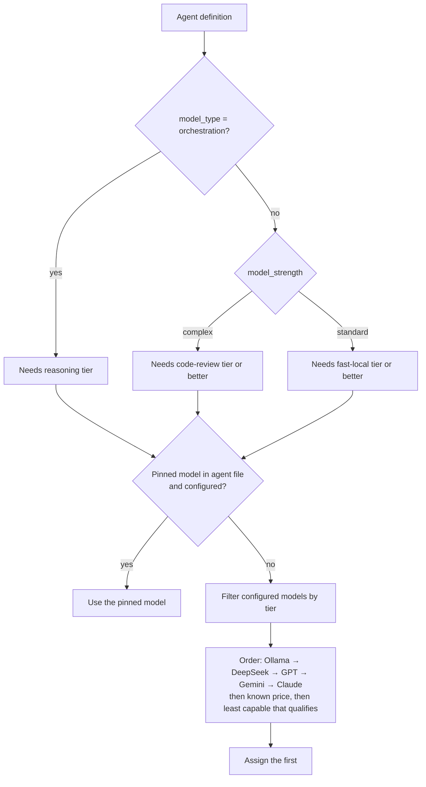

# Model routing

The `methodology-engine` plugin decides which model each agent runs on. The goal is simple:
**use the cheapest model that is good enough for the job**, so routine agents run on local or
low-cost models and frontier models are kept for orchestration and hard reasoning.

Source: [`model-router.js`](../framework/.opencode/plugins/lib/model-router.js),
[`model-profiler.js`](../framework/.opencode/plugins/lib/model-profiler.js),
[`methodology-engine.js`](../framework/.opencode/plugins/methodology-engine.js).

## 1. Discover

The router reads the models you have configured in OpenCode:

- `model` and `small_model`
- `provider.<id>.models.*`
- `agent.<name>.model`

It does **not** call provider APIs. An agent file's own `model:` line is treated as a
preference: it wins only if that model is actually configured.

## 2. Classify

Each model is placed in a capability tier from its provider and name (and parameter count for
local models):

| Tier | Rank | Examples |
|---|---|---|
| `reasoning` | 0 | Claude Opus, GPT-5.x, o1/o3, DeepSeek pro/reasoner, Gemini pro, local ≥70B |
| `code-review` | 1 | Claude Sonnet, GPT-4.x, local 14B–70B |
| `code-capable` | 2 | Claude Haiku, GPT-4.1-mini, DeepSeek, Gemini flash |
| `fast-local` | 3 | local 3B–14B (Llama 3.1 8B, Qwen 2.5 7B) |
| `fast` | 4 | any other local or mini model |
| `standard` | 5 | unclassified |

## 3. Assign (this changes which model runs)

In OpenCode's `config` hook the plugin sets `cfg.agent[name].model` for every agent:

## 4. Role table (informational)

A second table maps roles (orchestrator, implementer mechanical/standard/complex, spec and
quality reviewer) to models using the profile in `methodology-config.json`. It is cached in
`.opencode/plugins/.routing-cache.json`, rebuilt only when the configured model set changes
(SHA-256 of the model list), and shown to the agent in its first message. It informs the
agents' behaviour; it does not itself change which model OpenCode calls.

## Verification

| Check | How | Result |
|---|---|---|
| Classification | [`model-profiler.test.mjs`](../framework/test/model-profiler.test.mjs) | Opus → reasoning, Sonnet → code-review, Haiku → code-capable, local sizes by parameter count |
| Assignment through the real hooks | [`routing-e2e.test.mjs`](../framework/test/routing-e2e.test.mjs) loads the plugin into a throwaway project and calls its `config` and message hooks | Orchestrator → Opus, complex agents → Sonnet, standard agents → Haiku or local 8B; unconfigured pins ignored; configured pins honoured |
| Plugin loads in OpenCode | same test asserts every export is a function (OpenCode rejects the module otherwise) | passes |
| Live OpenCode run | OpenCode 1.19.6, providers pointed at a stub OpenAI-compatible server that logged the `model` of each request | `master-orchestrator` → `claude-opus-4-5`, `architect` → `claude-sonnet-4-6`, `story-writer` → `llama3.1:8b` |

**Not verified:** calls to the real Anthropic, OpenAI or DeepSeek APIs (no keys in the test
environment), and subagent hand-off from the orchestrator in a live session (each agent was run
directly).

## Configuration

| Want to… | Do this |
|---|---|
| Force a model for one agent | add `model: provider/id` to its frontmatter (must be configured in `opencode.json`) |
| Change what an agent needs | set `model_strength: complex` or `standard` in its frontmatter |
| Switch role-table profile | set `models.activeProfile` in `methodology-config.json` and restart |
| See current routing | run `/show-routing` |
